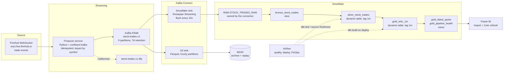

# Architecture

## The decision that shapes everything else

Version 1 of this project polled Finnhub's `/quote` REST endpoint on a timer,
wrote one JSON object per record to MinIO, and had Airflow re-scan the entire
bucket every sixty seconds. It called itself real-time. It was not: the
`/quote` endpoint returns a snapshot, not events, and the orchestration added
a one-minute floor on top of that.

Version 2 replaces the source with Finnhub's trade WebSocket and removes the
two components that were adding latency without adding value: the custom
consumer and the ingestion DAG.

## Data flow

## Latency budget

| Hop | Typical | Mechanism |
|---|---|---|
| Exchange to Finnhub socket | 100–500 ms | outside our control |
| Socket to Kafka | < 100 ms | `linger.ms=50` |
| Kafka to Snowflake RAW | ≤ 10 s | `buffer.flush.time=10` |
| RAW to silver | ≤ 60 s | dynamic table `target_lag = 1 minute` |
| silver to gold | ≤ 60 s | dynamic table, chained lag |
| gold to dashboard | ≤ 60 s | Power BI scheduled refresh |

End to end: roughly **90 seconds worst case, ~30 seconds typical**. Version 1
could not beat five minutes and had no way to measure itself.

`gold_pipeline_health` measures the exchange-to-warehouse portion of this
budget continuously, so the claim is verifiable rather than asserted.

## Why each component is here

**Kafka.** Decoupling and replay. If Snowflake is down for an hour, the topic
holds seven days of trades and the connector resumes from its committed
offset. Partitioned by symbol, so per-symbol ordering is guaranteed and the
partition count is the parallelism knob.

**KRaft, not Zookeeper.** Zookeeper was removed from Kafka in 4.0. A new
project should not ship it.

**Kafka Connect instead of a custom consumer.** The Snowflake connector using
Snowpipe Streaming handles offset management, exactly-once-ish delivery,
schema evolution, backpressure and a dead letter queue. The hand-written
consumer in version 1 handled none of those and had an at-most-once bug: it
auto-committed before the write, so a crash lost the message.

**Dynamic tables instead of a scheduled dbt run.** Snowflake refreshes them
incrementally on a declared lag. There is no orchestrator on the critical
path, and no scheduling gap where data sits in RAW waiting for a cron tick.
The cost is a constraint: incremental refresh requires the model to be an
aggregate, which is why `silver_stock_trades` dedupes with `GROUP BY` rather
than `qualify row_number()`.

**Views where the query genuinely needs a window function.**
`gold_latest_quote` needs `row_number` and `lag`. As a dynamic table it would
full-refresh every minute; as a view over an already-materialised aggregate it
is cheap and always current. Choosing the right materialisation per model is
the point.

**MinIO as an archive, not a critical path.** The S3 sink writes hourly
Parquet partitions in parallel with the Snowflake sink. If the warehouse loses
data or a model needs a backfill, the raw events are there. In version 1
MinIO was on the critical path and was the bottleneck.

**Airflow for the things that actually are batch.** Data quality on a cadence,
applying model changes on deploy, and daily cost telemetry. Not for moving
bytes every sixty seconds, which is what it was doing before and what it is
bad at.

## Known trade-offs

- **Single-broker Kafka.** `replication.factor=1` means a broker loss is data
  loss. Fine for a local demo, wrong for production. Three brokers and RF=3 is
  the fix; the config is otherwise unchanged.
- **Dynamic table cost.** A one-minute lag means Snowflake wakes the warehouse
  every minute, all day. The daily FinOps DAG exists because of this. If cost
  matters more than freshness, `gold_symbol_volatility` at 5 minutes shows the
  pattern to follow.
- **`MIN_BY`/`MAX_BY` in `gold_ohlc_1m`.** These may force a full refresh
  depending on Snowflake version. Check
  `information_schema.dynamic_table_refresh_history` and fall back to an
  incremental dbt model if the refresh mode is not `INCREMENTAL`.
- **Free-tier Finnhub covers US equities only,** and the trade socket is quiet
  outside market hours. `gold_pipeline_health.seconds_since_last_trade` will
  climb overnight; that is the market being closed, not a broken pipeline.
- **No schema registry.** The payload is JSON with an explicit
  `schema_version` field and a versioned topic name. Avro plus a registry is
  the next step; the version field is what makes that migration possible
  later.
